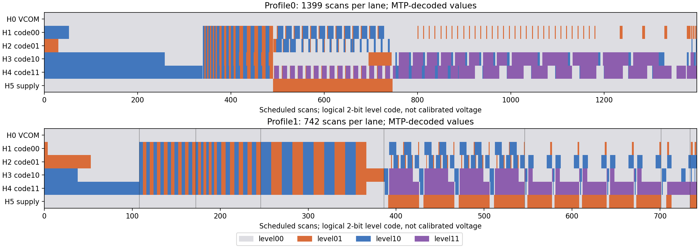

# 05 · MTP 压缩流与两张状态表

这是这次逆向里最关键的一块：**原厂 MTP 里的波形表不是明文，而是一段 LZ 压缩流。** 现在已经把它解开，拿到了两张 535 B 的状态表。

> 先划边界：这是**离线文件解码**，不是 SRAM 读回，也没有把整张表回灌到面板做电压/光学复现。它证明了“MTP 里存的是什么”，还没有证明“照这张表跑出来一定和原厂一样”。

## 1. 原始 dump

实验里用 R92 读出的 MTP：

```text
大小   4096 B
SHA256 150470090f544d6f8da303ce0fbe8f085c129e7b325e44bca9157a191dcddda4
```

R92 的读法是先发一个完整 dummy 字节，再读 4096 B；历史 dummy 是 `0E`。R92 有专门的读格式，不能套通用“发命令先等 ready”的流程。

这块屏的 R70 报告 `0E 02 01`，可以作为同一块控制器的旁证，但不要把 R70 当成 MTP 内容。

## 2. 4096 B 里有什么

| 偏移 | 内容 | 状态 |
| --- | --- | --- |
| `0x000–0x015` | 22 B wrapper | 未解 |
| `0x016–0x386` | LZ 压缩流 | **已解** |
| `0x387–0x47E` | 连续 `FF` 填充 | — |
| `0x47F` | 孤立 `77` | 角色未知 |
| `0x480–0xEFF` | 连续 `00` | — |
| `0xF00` | `43 4A 31 54 4D 01`（“CJ1TM” + `01`） | 工厂标识/头 |
| `0xF06–0xF56` | 连续 `00` | — |
| `0xF57` | `A5` 使能标记 | 对齐证据 |
| `0xF57–0xF84` | 46 B 默认设置区 | 已逐字节记录，但**不是**活动寄存器全量回读 |
| `0xF85–0xFFF` | JD 私有设置 | 不透明 |
| `0xFD0` | ASCII `NK863` | 工厂标识（“工厂标识”本身是假设） |

几个常见误解：

- `0x387` 开始的长 `FF` 不代表“压缩流在 0x387 结束”；解码游标在消费结束 token 后停在 `0x386` 的 bit 6（LSB 编号，即下一未读位）；实际流的最后一位是该字节的 bit 5。
- `0x47F` 的 `77` 在流结束之后，不能因为后面是 `FF/00` 就忽略它。
- `0xF57` 的 `A5` 是 MTP 内部的使能标记，不是发给芯片的 A5 命令。
- `0xF57–0xF84` 的默认设置和正常初始化写的值**不一样**；比如存储分辨率是 800×480，实际运行是 800×600。不要拿存储默认值当活动配置。

## 3. LZ 格式

从 `0x016` 开始，按**字节内 LSB first** 读位。整数也是 LSB first。

```text
0 + literal:8                    -> 输出一个字节
1 + length_code:8 + distance:14  -> 从 distance 字节前复制
                                    length_code + 3 字节
                                    （允许重叠复制）
length_code=255, distance=0      -> 结束
```

这次 dump 的实际统计：

| 项目 | 数量 |
| --- | ---: |
| literal | 374 |
| reference | 159 |
| end | 1 |
| 压缩位 | 7046 bit |
| 解压输出 | 11510 B |

把解析出的 token 重新序列化，和原始 7046 bit 逐 bit 一致。这证明“解析没有漏位”，但独立的正确性来自下面的实测对照。

### 关键顺序：先解 LZ，再做 R20 逆映射

```text
MTP[0x016...]
    → LSB-first LZ
    → R20 wire bytes
    → 逐字节取反/位重排逆映射
    → 逻辑状态表
```

以前直接把 R20 逆变换套到整份 MTP 上，得到的是“可逆查看副本”，不是解压。这个顺序不能反。

## 4. 两张 535 B 表

535 不是随便来的：

```text
535 = 7 字节头 + 6 条轨 × 8 个状态 × 11 字节
```

| profile | 解压偏移 | 长度 | 头部 | 六轨扫描数 |
| --- | ---: | ---: | --- | --- |
| 0 | 0 | 535 | `00 3C 28 78 3E 00 08` | 每轨 1399 |
| 1 | 535 | 535 | `00 22 24 78 22 00 08` | 每轨 742 |

profile 1 每条轨的 8 个状态扫描数都是：

```text
108, 64, 74, 140, 160, 155, 33, 8   // 六条轨相同，每条轨合计 742
```

profile 0 的六轨**总数**都是 1399，但内部每个状态的长度分配不同；它不是把 profile 1 简单放大。

### profile 1 和实测对上了什么

之前的 H5→H0 逐字段恢复，用 BUSY/VSL 得到过一套 742 扫描的代表表。把 MTP 解出的 profile 1 拿去比：

| 对照项 | 数量 | 不匹配 |
| --- | ---: | ---: |
| 有反例支持的语义推断位 | 3194 bit | 0 |
| 匹配候选位 | 66 bit | 0 |
| 六轨 9 个时长字段 × 8 状态代表字节 | 432 B | 1 个等价差异 |

唯一的差异是 **H5 state7.RB**：实测代表值选 0，MTP 解出 1。这个状态 D=E=F=0，RB 是 0 还是 1 都不增加扫描，属于事先就记录过的“未执行子组”等价差异。没有为了对齐去改旧检查点。

### 还从表里直接读到了什么

- H0–H4 的首状态 `G` 都是 **1**。以前只看全局 BUSY 分不清 0/1，这是文件来源的新证据；但它不是“以前已经用 BUSY 证明了 G=1”。
- H0 的 `ABC_levels` 字节是 `0x02`，`DEF_levels` 是 `0`；六个相位的 2bit 电平码都是 0，低两位的 bit1 保留。它和旧的 VCOM 近似直流观测相容，但低位用途仍未知。
- H5 的完整两个 level 字节都拿到了，包括以前没有单独观测的位；H1–H4 的像素电平字节也有了 MTP 来源候选值。
- profile 1 头部最后一个字节是 `08`。它和“R20[6] 任一单 bit 置位可恢复 H1 首槽计数”的实验相容，但不能由此认定这个字节的完整语义就是“使能”。

## 5. 图上看什么



- 横轴是计划扫描数，纵轴是 H0–H5。
- 颜色是**逻辑 2bit 电平码**，不是物理电压，也不是屏幕颜色。
- profile 1 的六轨总长一致（742），但内部相位分配不同。图中展示的是解码结果，实测对照的证据见上一节。

## 6. 还没解释的

1. **22 B wrapper**：`01 A5 03 0F 7F ... 00 01 14`。里面的 `0F` 和 15 个 `7F` 很像温区/选表信息，但 15 °C 阈值和选表规则没有验证。
2. **profile 0 / 1 怎么选**：两张表一长一短，可能是不同温度档；现在只叫 profile 0/1，不叫“冷/暖”。
3. **1070–1121 的 52 B**：不是表，也不是全零；用途未知。
4. **1122 之后的全零**：不能把整个 11510 B 当成可上传的 R20 payload。
5. **`0x47F` 的 77**：在流结束之后，容器角色未知。
6. **整表回灌**：535 B 原样上传后的 BUSY/VSL/光学复现没做。
7. **通用性**：只验证了这一份 dump、这一块面板；不能据此宣称拿到了通用原厂编译器或所有温区格式。

## 7. 复现

```sh
cd host

# 解 dump，打印摘要；会校验 SHA、头部、六轨总数
python3 decode_mtp.py

# 把 535 B 表打印成逐状态的人话
python3 show_profile.py --lane 5

# 把解码结果重新写到 data/
python3 decode_mtp.py --out ../data

# 全套离线自检
python3 selftest.py
```

`decode_mtp.py` 不依赖 numpy/scipy，也不开串口。它只读 `data/mtp.bin`。

## 8. 和旧实验掩码的关系

MTP 解出的字节是**文件来源**，不是新的 SRAM 读回。旧 oracle 的 `inferred / candidate / unresolved` 掩码仍然只描述当时真机实验的可辨识性；两者不要混成一套“原厂字节已全部读回”的说法。

这也是为什么本包把两件事分开写：

- **测量能证明的**：BUSY/VSL 下的时长、相位、重复、部分电平行为；
- **文件能证明的**：MTP 里确实存了哪 535 B、头部是什么、G 和电平字节是什么。

两者在 profile 1 上对上了，这是强证据；但“整表在硬件上跑出来是什么样”仍然没有做。

下一章：[边界与安全](06-limits-and-safety.md)。
